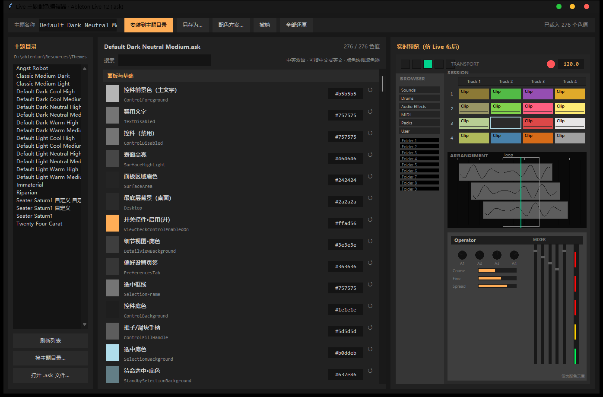
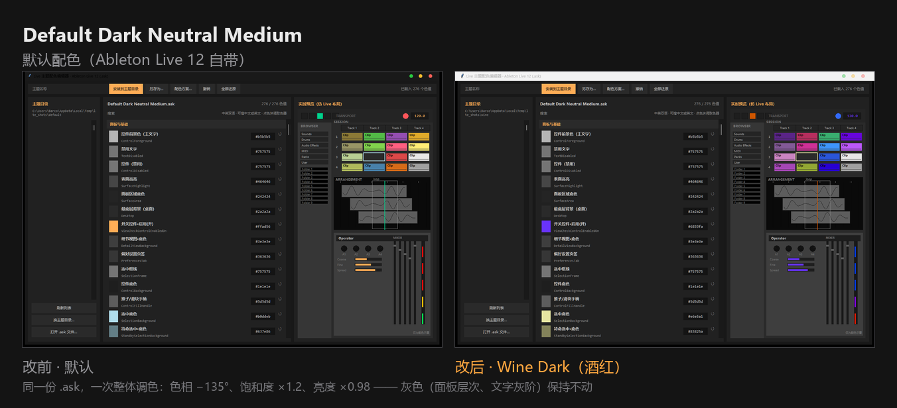
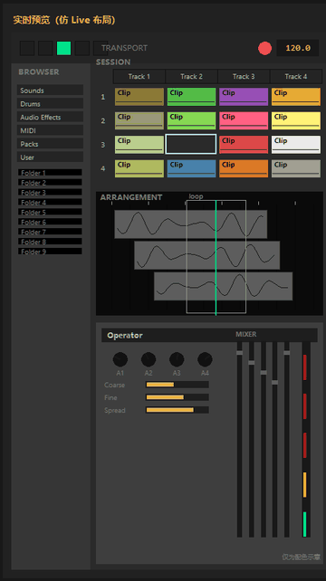

# AbletonLiveThemeEditor

A GUI editor for **Ableton Live 12** theme files (`.ask`) — pick colors, preview them Live-style, write the file back without breaking its formatting.

[中文说明](README.md)



Before / after — the same `.ask`, one bulk color-scheme pass (preset "Wine Red"):



The six built-in presets (cool blue → forest green → wine red → violet → sunset orange → mono grey); only colored tokens move, neutrals stay put:



## Why

Live 12 themes live in `Resources/Themes/*.ask`. Each file is a plain XML color table: 276 color entries, including five nested VU-meter palettes. Tweaking one color means scrolling hundreds of lines, editing hex by hand, then restarting Live to see whether it looks right.

This tool turns the whole table into a searchable list with a live preview.

## Features

- **Three-pane UI** — theme list on the left, 276 color tokens grouped by meaning in the middle, Live-style preview on the right (transport, browser, session grid, arrangement waveforms, device knobs and meters)
- **Bilingual token names** — 234 tokens have Chinese labels; search matches both Chinese and English
- **Three ways to change a color** — system color picker, direct hex input (`#RRGGBB` / `#RRGGBBAA`), or per-row reset
- **Color schemes** — shift hue (−180…+180), saturation (0.3…1.8) and lightness (0.7…1.3) across the whole theme, plus six presets (cool blue, forest green, wine red, violet, sunset orange, grayscale). Neutral grays are left untouched so the panel hierarchy survives
- **Multi-step undo**, undo for bulk scheme changes included, plus full reset
- **Safe saving** — only the `Value="…"` on the matching line is replaced; indentation, line count and XML structure stay byte-identical. Change N colors, get N changed lines
- **One-click install** into the Live themes folder

## Download

Grab the `LiveThemeEditor-v1.0.0-win64.zip` from [Releases](../../releases) — it contains `LiveThemeEditor.exe`. No Python required.

On first launch it looks for the themes folder in this order:

1. `--themes-dir "<path>"` on the command line
2. `ABLETON_THEMES_DIR` environment variable
3. Common install paths (`<drive>:\ProgramData\Ableton\Live*\Resources\Themes`, `<drive>:\Ableton\Resources\Themes`, …)
4. A `Themes` folder next to the exe (created if missing)

You can always change it with **Change themes folder…** in the lower-left corner.

## Run from source

```
python live_theme_editor.py                  # needs tkinter (bundled with python.org builds)
python live_theme_editor.py --selftest       # headless check: parse / edit / write-back
python live_theme_editor.py --themes-dir "D:\Ableton\Resources\Themes"
```

Standard library only.

## Making your own theme

1. Pick a base theme (recommended: `Default Dark Neutral Medium` or `Default Light Neutral Medium`)
2. Edit colors, or use **Color scheme…** for bulk adjustment
3. Rename the theme at the top, click **Save as…** (don't overwrite the bundled `Default *.ask`)
4. Click **Install to themes folder**
5. Restart Live → Settings → Look and Feel → Theme, and your theme is in the list

## Bundled example themes

`examples/` ships three ready-to-use `.ask` files — drop them into `Resources\Themes` and they show up in Live:

| File | Based on | Look |
| --- | --- | --- |
| `Wine Dark.ask` | Default Dark Neutral Medium | wine red, dark panels |
| `Forest Light.ask` | Default Light Neutral Medium | forest green, light panels |
| `Mono Grey.ask` | Default Dark Neutral Medium | near-grayscale, hierarchy intact |

Regenerate or tweak them with `python tools/make_examples.py <themes dir> <out dir>` — same algorithm as the in-app scheme presets (about 105 colored tokens per theme, neutrals untouched).

## Shortcuts

| Key | Action |
| --- | --- |
| `Ctrl+S` | Install to themes folder |
| `Ctrl+Z` | Undo one step |
| `F5` | Refresh theme list |

## Build it yourself

```
pip install pyinstaller
python -m PyInstaller --noconfirm --onefile --windowed --name LiveThemeEditor ^
  --icon assets\icon.ico --version-file tools\version_info.txt live_theme_editor.py
```

Or just run `tools\build.ps1`, which also handles the Microsoft Store Python user-site path quirk. The icon is generated by `tools/make_icon.py` (needs Pillow).

## Notes

- `.ask` files are pure XML describing colors; nothing executable, and the tool never touches the Live installation itself.
- Treat the bundled `Default *.ask` files as read-only — save as a new name first.
- This tool only edits colors; it does nothing about licensing or installation.

## License

MIT — not affiliated with or endorsed by Ableton AG. "Ableton" and "Live" are trademarks of Ableton AG.
