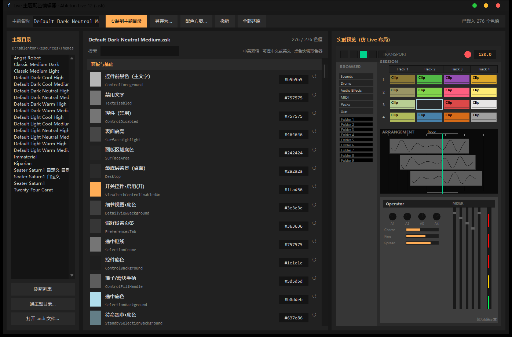
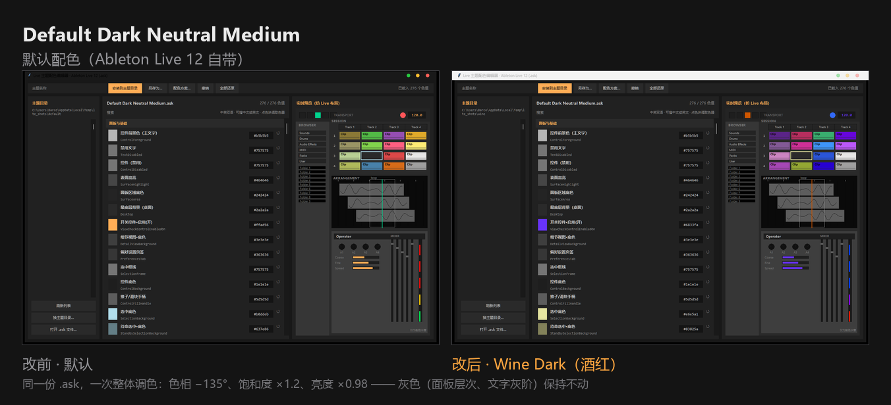
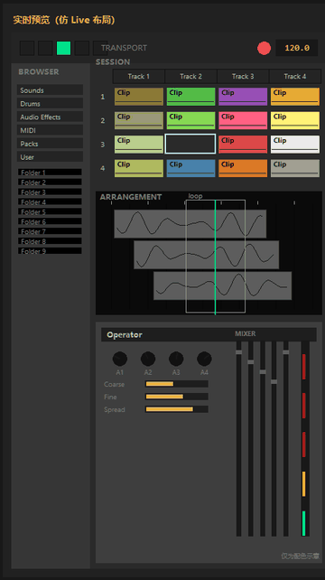

# AbletonLiveThemeEditor

一个专门用来定制 **Ableton Live 12** 配色（`.ask` 主题文件）的图形化编辑器。
A GUI editor for Ableton Live 12 theme files (`.ask`) — pick colors, preview them Live-style, ship a theme.

[English](README.en.md)




改前 / 改后 —— 同一份 `.ask`，一次整体调色（预设「酒红」）：



六个预设的效果（冷蓝 → 森绿 → 酒红 → 紫罗兰 → 落日橙 → 灰调），只动彩色、灰色保持不动：



## 为什么需要它

Live 12 的主题是 `Resources/Themes/*.ask`，本质是一个纯 XML 颜色表：276 个色值条目、5 组嵌套的电平表配色。改一个颜色要翻几百行 XML，改完还得靠猜才知道是什么样。

这个工具把整张颜色表变成可搜索的列表 + 实时预览，点什么改什么。

## 功能

- **三栏界面**：左侧主题列表（读 `Themes` 目录里的所有 `.ask`）/ 中间 276 个色值按语义分组可搜索 / 右侧仿 Live 的实时预览（transport、浏览器、Session 网格、Arrangement 波形、Device 旋钮与电平表）
- **中英双语色名**：234 个色值全部配了中文名（`片段颜色 7`、`电平表·零下 1`、`控件前景色（主文字）`…），中文名在上、英文原名在下，搜索框中文英文都能搜
- **三种改色方式**：点色块开系统取色器；直接输 `#RRGGBB` 或 `#RRGGBBAA` 回车生效；行尾 ↺ 单色还原
- **自定义配色方案**：整体调色对话框 —— 色相偏移 −180…+180、饱和度 0.3…1.8、亮度 0.7…1.3，另有冷蓝 / 森绿 / 酒红 / 紫罗兰 / 落日橙 / 灰调六个预设。只动彩色，灰色（背景、面板层次、文字灰阶）保持原样，不会糊成一片
- **随机配色**：一键换一套 —— 整体随机（全主题统一一个随机色相，明暗层次和灰色骨架保留）、逐色随机（每个彩色值各拿一个色相，灰色不动）或全部随机（色相/饱和/明度全部重掷，连文字和背景也一起打乱）；三种都各算一步撤销，可以连点到满意为止
- **多步撤销**（单色一步、整体调色一步）、**全部还原**
- **保存安全**：逐行只替换该行的 `Value="…"`，缩进、行数、XML 结构完全不动。改 N 个色值就只有 N 行不同
- **一键安装**到主题目录，Live 里直接选

## 下载使用

到 [Releases](../../releases) 下载 `LiveThemeEditor.exe`，双击运行，不需要装 Python。

首次启动会自动找主题目录，查找顺序：

1. 命令行 `--themes-dir "<目录>"`
2. 环境变量 `ABLETON_THEMES_DIR`
3. 常见安装路径（`<任意盘>:\ProgramData\Ableton\Live*\Resources\Themes`、`<任意盘>:\Ableton\Resources\Themes` 等）
4. 都找不到就用 exe 同级的 `Themes` 目录（可手动指定）

界面左下角 **换主题目录…** 可以随时改。

## 从源码运行

```
python live_theme_editor.py                  # 需要 tkinter（官方 python.org 安装包自带）
python live_theme_editor.py --selftest       # 无窗口自检：解析 / 改色 / 按行写回
python live_theme_editor.py --themes-dir "D:\Ableton\Resources\Themes"
```

只依赖标准库。Windows 上建议用带 Tk 的解释器（Microsoft Store 版 Python 3.11 也可以）。

## 自定义主题怎么落地

1. 左栏选一个基础主题（推荐 `Default Dark Neutral Medium` 或 `Default Light Neutral Medium`）
2. 改颜色，或用 **配色方案…** 整体调色
3. 顶部改「主题名称」，按 **另存为…** 存成新文件（别直接覆盖 `Default *.ask`）
4. 按 **安装到主题目录**（或把 `.ask` 手动拷进 `Resources\Themes`）
5. 重新打开一次 Live 的设置（`Ctrl+,`）→ Look and Feel → Color & Theme 的主题下拉里就有了，不用重启 Live

## 附带示例主题

`examples/` 里有三个做好的 `.ask`，拷进 `Resources\Themes` 就能在 Live 里直接选：

| 文件 | 基于 | 效果 |
| --- | --- | --- |
| `Wine Dark.ask` | Default Dark Neutral Medium | 酒红调，暗色面板 |
| `Forest Light.ask` | Default Light Neutral Medium | 森绿调，亮色面板 |
| `Mono Grey.ask` | Default Dark Neutral Medium | 近灰阶，只剩层次感 |

想批量重做或改参数：`python tools/make_examples.py <Themes 目录> <输出目录>`，用的是和界面里「配色方案…」预设完全一致的算法（每个主题只改约 105 个彩色色值，灰色保留）。

## 快捷键

| 键 | 作用 |
| --- | --- |
| `Ctrl+S` | 安装到主题目录 |
| `Ctrl+Z` | 撤销一步 |
| `F5` | 刷新主题列表 |

## 自己打包

```
pip install pyinstaller
python -m PyInstaller --noconfirm --onefile --windowed --name LiveThemeEditor ^
  --icon assets\icon.ico --version-file tools\version_info.txt live_theme_editor.py
```

或直接跑 `tools\build.ps1`（会自动处理 Microsoft Store 版 Python 的 user-site 路径问题）。
图标由 `tools/make_icon.py` 生成（需要 Pillow）。

## 目录

```
LiveThemeEditor/
├─ live_theme_editor.py     主程序（单文件，Tkinter，无第三方依赖）
├─ token_labels.py          234 个色值的中文名对照表
├─ README.en.md             英文说明
├─ 启动编辑器.cmd            源码运行用的双击启动器
├─ examples/                三个现成的示例主题（酒红 / 森绿 / 灰调）
├─ assets/
│  ├─ icon.ico / icon.png   应用图标
│  ├─ preview.png           界面截图
│  ├─ before-after.png      改前改后对比
│  ├─ scheme-demo.gif       六个配色预设的轮播
│  └─ social-preview.png    GitHub 社交预览图
├─ tools/
│  ├─ make_icon.py          图标生成
│  ├─ make_examples.py      从 Live 自带主题批量生成示例配色
│  ├─ version_info.txt      exe 版本信息
│  └─ build.ps1             一键打包
└─ README.md
```

## 说明

- `.ask` 是纯 XML，只描述颜色，不含任何可执行内容；工具不会改动 Live 本体。
- Live 自带的 `Default *.ask` 建议只读不写，先另存为再安装，免得默认配色被覆盖。
- 这个工具只处理配色，不涉及 Live 的授权与安装。

## License

MIT
